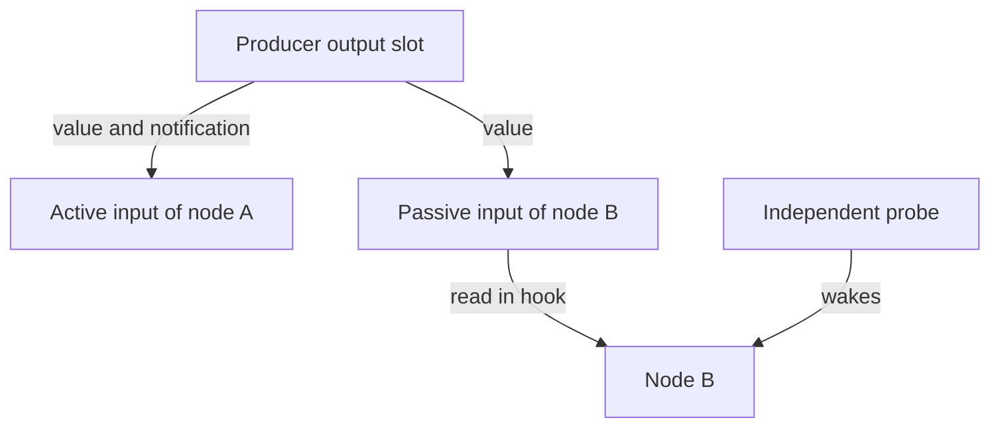

# Endpoint storage

**Proposed.** Store a publication once, at the producer. Give each receiving
input its own binding. Two inputs wired to the same output can have different
activity and still read the same value, delta and timestamp.

## Direct scalar

| Stored once per | Fields |
| --- | --- |
| Output | Typed payload slot, optional last-publication time, range of subscribing bindings. For a direct scalar the timestamp also encodes validity. A valid nullable payload can hold null. |
| Input binding | Producer slot, receiving node and activity. Passivation removes this binding as a wake source. |
| Node | Ready flag for this cycle. A clear can set this flag even though the producer has no current publication. |

For a valid direct scalar, `modified` compares its publication time with
the current evaluation time. Its delta is the payload published at that
time. No cycle-end pass has to clear endpoint flags.

| Action in this cycle | Valid | Modified | Last publication | Active consumer |
| --- | --- | --- | --- | --- |
| Publish 7, including a repeated 7 | yes | yes | now | wakes |
| Silence after 7 | yes | no | retained | sleeps unless woken elsewhere |
| Publish null to a nullable output | yes | yes | now | wakes |
| Clear a valid output | no | no | absent | wakes |
| Clear an invalid output | no | no | absent | no wake from this clear |

A write followed by a clear in one hook leaves a ready consumer observing
an invalid endpoint. Reversing the operations leaves a publication. Read
the final state when the consumer runs. [Core endpoint contract, END-1–6][end] ·
[Ordered writes][writes] · [Binding activity][activity]

## Layout and access

Put fixed endpoint metadata in graph-owned arrays. Group payload slots by
concrete type in pre-sized Rust vectors. The plan supplies the typed index
for each direct input. Fan-out adds bindings, with no per-edge payload
copies. Store a hook function pointer per node description. Inside a
generated scalar hook the payload type is known. Generic traversal uses
the endpoint shape's operations to visit children or build a delta.

A view borrows storage for a hook. Use an owned value at a retention point.
In particular, the next collection update may reuse delta storage while
core's recorder still holds the preceding delta. Each tuple written to
the store at stop must preserve what the recorder saw at publication.
[Core eval, CEVAL-4][eval]

## Endpoints with structure

| Shape | Extra state and observable consequence |
| --- | --- |
| Struct, tuple, fixed list | Fixed child slots. Each child has its own validity. A whole read needs `all_valid` of that endpoint. It tests direct required children one level deep. |
| Growing list, dictionary | Track membership separately from child validity and from this cycle's edits. Represent a published empty collection explicitly. Shrinking a list retires the dropped slots and records their removal in the delta. |
| Set | Retain members and the added/removed delta. Membership changes can start or stop a child graph. |
| Reference | Retain the designated endpoint's identity. Repeating a designation is silent. A follower also observes publications of the selected target. |
| Atomic value, signal input | An atomic payload publishes whole. A signal input observes a connection's ticks without reading its payload. |
| Window | Keep arrivals in time order. For a duration window, evict on arrival while age exceeds the maximum. A value at the boundary stays. Eviction alone produces no publication. |

On an already valid growing list, publishing the whole empty list ticks.
Applying an empty list delta leaves it quiet. On an invalid growing list
that same delta establishes a valid empty list and ticks. Preserve the
kind of write across the compiler handoff. [TIME-7][time] · [END-3][end]

Within a graph instance, identify a dynamic child slot by index and generation.
Removing it retires that generation. A later child at the same index
cannot be reached through the old handle. Keep the logical key or index in
a binding that must follow membership changes, and resolve it on rebind.
[Temporal model, TIME-10][time] · [Core endpoints, END-7–10][end]

[end]: https://github.com/hhenson/hgl_core/blob/40c3e6ff8391c4cfd2821e9fc5f2cffc3450ab68/spec/temporal-endpoints.md
[writes]: https://github.com/hhenson/hgl_core/blob/40c3e6ff8391c4cfd2821e9fc5f2cffc3450ab68/tests/conformance/scalar_transitions.hgl
[activity]: https://github.com/hhenson/hgl_core/blob/40c3e6ff8391c4cfd2821e9fc5f2cffc3450ab68/tests/conformance/input_activity.hgl
[eval]: https://github.com/hhenson/hgl_core/blob/40c3e6ff8391c4cfd2821e9fc5f2cffc3450ab68/spec/testing-and-eval.md
[time]: https://github.com/hhenson/hgl_spec/blob/a3716ccadbb8b0601bc5b1d35f41eac57b9c6778/spec/language/temporal-model.md
