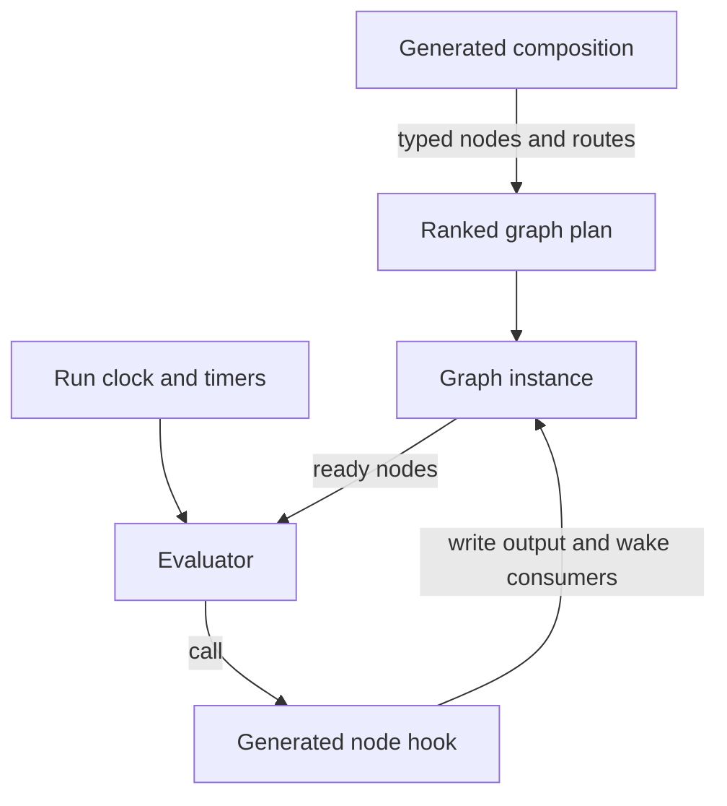

# Graph and evaluation

**Proposed.** Compile node bodies and graph composition to Rust. Finish the
graph once its connections are known. Each run owns the mutable state of
every instance it creates.

## Compiler handoff

| Owner | Decision |
| --- | --- |
| Compiler | Resolve declarations and concrete types. Emit graph composition, hook bodies, handler admission and source order, plus the points where values must be retained. Carry the HGL source location of each node. |
| Runtime planner | Accept concrete node descriptions, typed ports, endpoint paths, same-cycle dependencies and child captures. Check route types, reject same-cycle loops and rank each node one above its highest predecessor. Resolve fixed paths to slots. |
| Core provider in this runtime | Bind core native declarations by resolved identity and concrete type. Supply endpoint operations, clocks, scheduler, alarm, logger and the typed run store. Supply value primitives, including list mutation and scalar operators, as their declarations are reached. |

The handoff is Rust source linked with the runtime. A generated hook gets
its state, its input views, its writable output if any, and its declared
capabilities. The runtime invokes it once per evaluation. The hook checks
its handlers in source order and returns on the first executed HGL
`return`. The compiler checks guards on statically named child reads.
A read through an index known only during evaluation checks validity then.
[Native boundaries][native] · [Temporal model, TIME-1–5][time]

## What one run owns

| Lifetime | Proposed representation |
| --- | --- |
| Finished plan | Immutable arrays of node descriptions in rank order, input routes and subscriber ranges. Node descriptions select the concrete hook and storage layout at construction. |
| Run | Clock, deadline queue, typed store and root instance. Seed the store before composition so graph construction and node hooks see the same entries. |
| Graph instance | One wake flag per node, input bindings, output slots, node state and cache. Instances of the same child template share its plan. Each has its own storage. |
| Hook call | Short-lived views into that instance. The evaluator holds exclusive access while the hook runs. Retaining a payload in state, the store or a recording gives it independent value semantics. |

Initialize node state before start, preserving restored state when supplied.
Rebuild the cache on every start. Give stop hooks access to final readable
inputs. Rust releases the storage after semantic teardown.

## One cycle

1. Take the next due instant inside the run bounds. Simulation jumps there.
   Real time waits until it is due. Mark due sources and timers. Keep a
   delivered scheduler wake visible throughout the hook, including after a reset.
2. Walk the node array in rank order. An active input change marks its
   consumer ready. Two inputs marking the same node set the same flag.
   Activity controls wakes. The hook can still inspect a passive input.
3. A hook updates its own output in program order. Later ranks see the
   completed publication or invalidation at the same logical time.
   Nodes of equal rank have no HGL ordering guarantee.

For the core diamond, an input of 1 reaches the join as 2 on the short
branch and 3 on the long one. The short branch marks the join ready. The
join runs after the second branch finishes and adds 5 to its state once.
[Diamond case][diamond]

## Construction and teardown

Track successful starts in order. On exit, stop them in reverse order,
including after partial startup or a hook failure. Keep inputs, outputs and
the store alive through stop. A successful run reads its recording after
stop. A failed run discards the output and reports the node and phase.
A captured HGL evaluation failure goes to the nearest capture boundary.
Earlier writes survive and the child can run again. Start and stop failures
escape capture. A returned error value remains data. An engine fault aborts the run.
[Execution, CRUN-1–8][run] · [Capture cases][capture]

A switch owns its active child. A keyed loop owns one child per current
member. Rank the host after its captured producers and before its consumers.
Run due child work at the parent's logical time before forwarding its result.
Updating a member keeps its state. Removing it stops the child,
detaches routes, cancels its wakes and releases its slots. Reinsertion
starts a fresh child. Producers captured from the parent keep their lifetime.
[Control flow, CTRL-2 and CTRL-7][control]

[native]: https://github.com/hhenson/hgl_spec/blob/a3716ccadbb8b0601bc5b1d35f41eac57b9c6778/spec/language/native-boundaries.md
[time]: https://github.com/hhenson/hgl_spec/blob/a3716ccadbb8b0601bc5b1d35f41eac57b9c6778/spec/language/temporal-model.md
[control]: https://github.com/hhenson/hgl_spec/blob/a3716ccadbb8b0601bc5b1d35f41eac57b9c6778/spec/language/control-flow-and-sources.md
[run]: https://github.com/hhenson/hgl_core/blob/40c3e6ff8391c4cfd2821e9fc5f2cffc3450ab68/spec/execution.md
[diamond]: https://github.com/hhenson/hgl_core/blob/40c3e6ff8391c4cfd2821e9fc5f2cffc3450ab68/tests/conformance/graph_cycles.hgl
[capture]: https://github.com/hhenson/hgl_core/blob/40c3e6ff8391c4cfd2821e9fc5f2cffc3450ab68/tests/conformance/captured_failures.hgl
